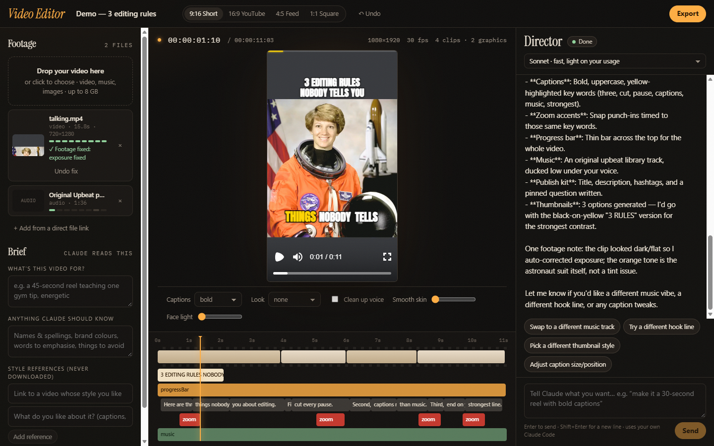
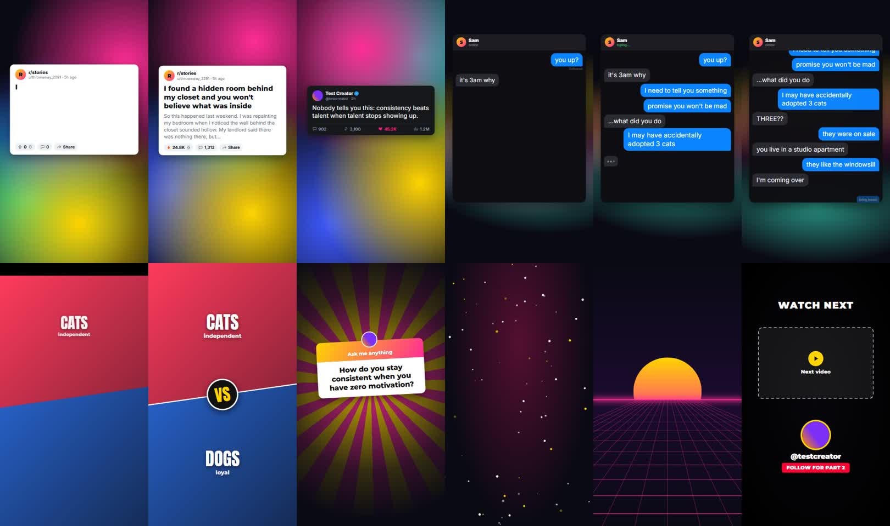
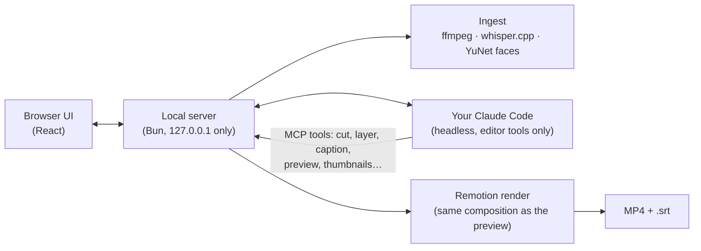
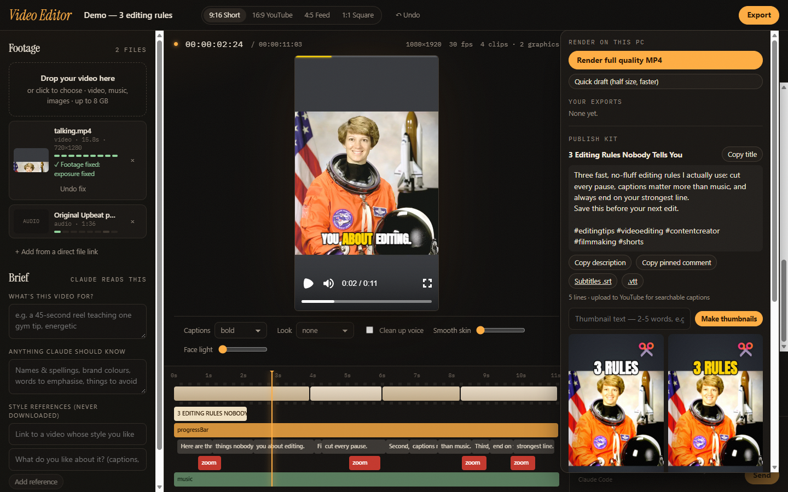
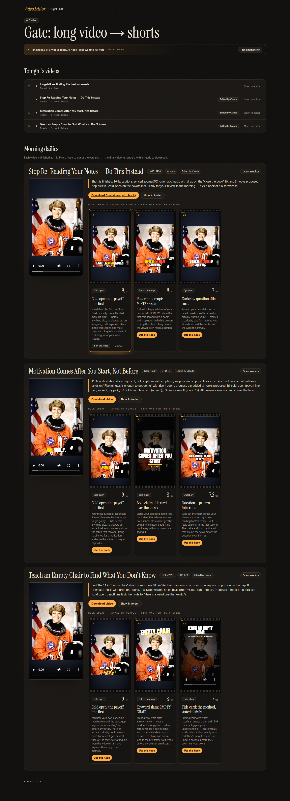
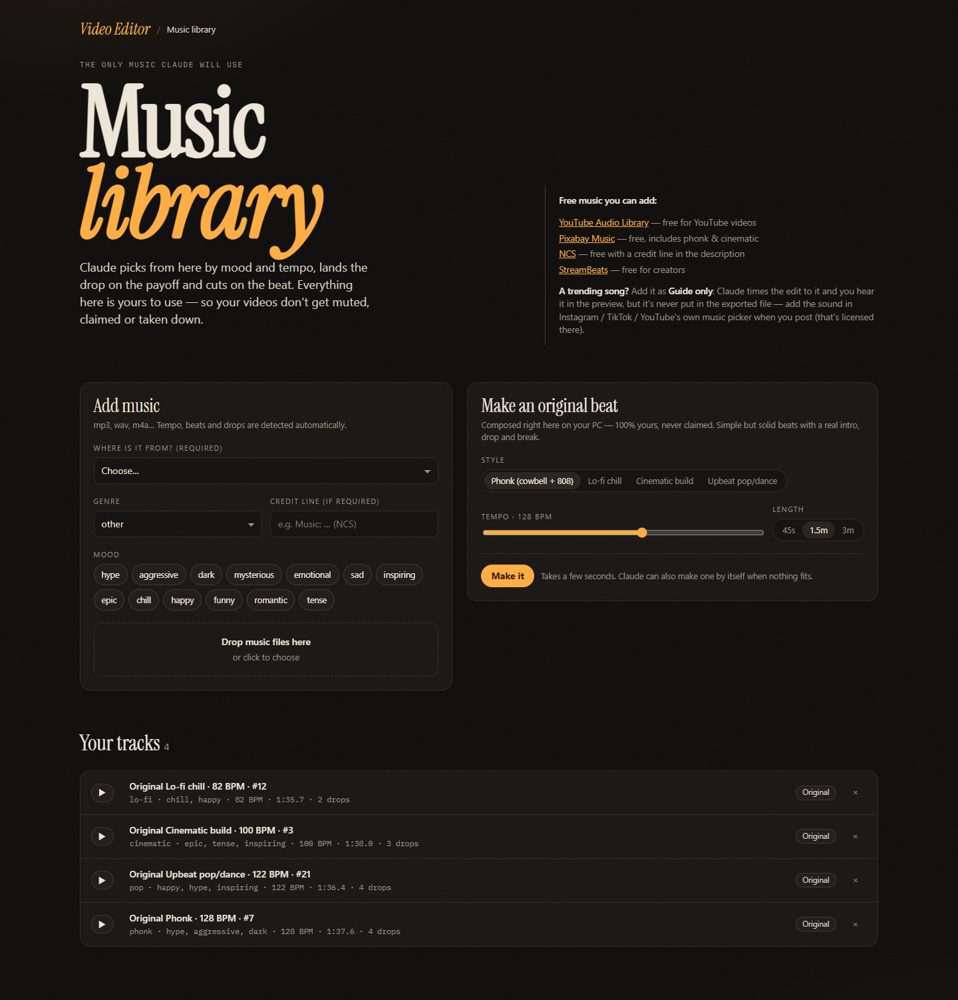

# Video Editor

**A local AI video editor for creators.** Drop in a clip (or a few), say what you want in plain words, and Claude
cuts, captions, designs, scores and exports it — on your own PC. Or hand it a batch at night with **Night Shift** and
wake up to finished videos, hook ideas, titles, thumbnails and subtitle files.

[](https://github.com/haidermoulay3mk/local-ai-video-editor/actions/workflows/ci.yml)


[](LICENSE)



## What it does

| | |
|---|---|
| **Edits from plain words** | "Make this a punchy 30-second reel: cut the pauses, bold captions, a hook title, zoom on the key words." Claude plans the edit, applies it, renders preview frames, checks its own work and tells you what it did. Every change can be undone. |
| **Footage repair** | Spots dark, flat, shaky or colour-cast footage and fixes it (stabilize, denoise, exposure, white balance) before editing. Every export is loudness-mastered to −14 LUFS, the level platforms normalise to. |
| **Cuts & pacing** | Silence and filler-word removal, punch-in zooms that hide jump cuts, speed ramps, snap zooms on key words, vertical reframing that follows your face. |
| **Captions** | Word-timed captions in 12 styles (hormozi, single-word, karaoke, outline, gradient…), right-to-left Arabic, fixes for misheard names. |
| **Motion** | 17 transitions (zoom punch, glitch, whip, smooth slide, shutter…), camera moves on every clip, 19 text animations, 19 motion-graphics templates. |
| **Faceless formats** | Reddit/tweet-style story cards, text-message chats, "A vs B", Q&A stickers, animated backgrounds, split screen (you on top, gameplay below), AI voiceover, free stock photos and AI images. |
| **Music & sound** | Original beats generated on your PC, tracks you add with a licence, cuts on the beat, the drop landed on the payoff, music ducked under speech, built-in sound effects. |
| **Publish kit** | Title, description, hashtags and chapters written for you, thumbnail options rendered from your best face frame, and an `.srt` subtitle file next to every export. |
| **Night Shift** | Queue clips — or a long video to cut into shorts, or a script for a long-form video — go to sleep, and review finished videos with ranked hook ideas in the morning. |



## How it works



- **The whole edit is one JSON document** (the *Edit Spec*). Claude changes it only through the editor's own tools;
  the preview player and the final render draw it with the same Remotion composition, so what you see is what you
  export.
- **Claude is sandboxed.** It runs headless with no shell, no file access and no web — only the editor's MCP tools —
  and it looks at rendered frames of its own edit before calling it done.
- **Everything heavy runs locally:** ffmpeg, whisper.cpp (captions), YuNet (face tracking), Kokoro (AI voice) and
  Remotion + headless Chrome (rendering). Your footage never leaves your PC.

More detail in [docs/ARCHITECTURE.md](docs/ARCHITECTURE.md).

## Requirements

- **Windows 10 or 11 (64-bit).** Setup downloads Windows builds of ffmpeg and whisper.cpp.
- **8 GB RAM minimum, 16 GB recommended** — rendering uses headless Chrome and every CPU core.
- **About 3 GB of free disk** for dependencies, tools and models, plus room for your videos.
- [**Bun**](https://bun.sh) 1.3+ and [**Node.js**](https://nodejs.org) 20+ (rendering and the AI voice run in Node).
- [**Claude Code**](https://code.claude.com/docs), installed and signed in with **your own Claude account or your own
  API key**. Claude's usage is billed to you by Anthropic under your plan or key; this app never sees, stores or
  forwards your credentials. Without Claude, uploading, transcription, footage fixes, the quick controls and
  exporting still work — the editing itself is Claude's job.

## Install

```bash
git clone https://github.com/haidermoulay3mk/local-ai-video-editor.git
cd local-ai-video-editor
bun install
bun run setup
```

`bun run setup` downloads ffmpeg, whisper.cpp with its speech model and the face model into
`%LOCALAPPDATA%\Video Editor` — never into the project folder. Then:

```bash
bun start
```

and open <http://127.0.0.1:4600>. On Windows you can also double-click **`Start Video Editor.cmd`**: it starts the
editor and opens your browser.

> **Optional:** on the Home screen, tick **Subscription only** if you want the editor to stop rather than ever bill an
> API key instead of your Claude plan.

## Your first edit

1. **New video** → pick where it will be posted (Short/Reel 9:16, YouTube 16:9, Feed 4:5, Square).
2. **Drop your video** on the left. It's transcribed, pauses are found, your face is tracked and the picture is checked.
3. **Tell Claude what you want** in the Director chat — or click one of its suggestions.
4. Watch the preview update, ask for changes in plain words, **↶ Undo** anything.
5. **Export** → render the MP4, copy the title and description, download the subtitles and a thumbnail.

Things you can say:

- "Cut the pauses, bold captions, and zoom in when I say something important."
- "Captions are covering my chin — make them bigger and move them up."
- "Turn this Reddit story into a faceless short with a voiceover and stock photos."
- "Split screen: me on top, the gameplay clip underneath."
- "Give me four hook ideas for the opening."



## Night Shift

Open **Night Shift** → *Plan tonight's shift* → add clips (or drop them into `Videos\Video Editor Inbox`) → choose
*one video per clip*, *one video from all clips*, *long video → shorts* or *long-form from a script* → start now or
schedule it. Overnight, every video is analysed, edited, self-reviewed and exported, and Claude proposes 3–5 hooks
(cold open, bold claim, curiosity question…) with a preview render of each. In the morning, press **Use this hook** on
the one you like and the final video re-renders with it.

It's built to survive a night on its own: if your Claude usage limit is reached it waits for the reset; if that's too
far away, the remaining videos still get an automatic edit. It keeps the PC awake during a shift and resumes after a
restart.



## Music and voiceovers



- **The music library is the only music Claude uses.** Tracks are analysed for tempo, beats and drops, so Claude picks
  by mood, lands the drop on the payoff and cuts on the beat.
- **Original beats made on your PC** (phonk, upbeat pop, cinematic, lo-fi): yours, so videos never get claimed. For a
  more polished sound, add tracks from free creator libraries (YouTube Audio Library, Pixabay Music, NCS…).
- **Trending songs** can be added as **guide only**: Claude times the edit to them and you hear them in the preview,
  but they're never put into the exported file — add the sound with the platform's own music picker when you post.
- **Voiceovers:** a natural AI voice (Kokoro, free and local, 8 voices) reads scripts; captions follow it
  automatically.

## Optional free extras

Stock photos (public domain, via [Openverse](https://openverse.org)) and AI images work with no keys. Under **Free
extras** on the Home screen you can add free keys, stored only on your PC:

| Key | Unlocks |
|---|---|
| [Pexels](https://www.pexels.com/api/) | Stock **video** B-roll and more photos |
| [Pollinations](https://auth.pollinations.ai) or [Hugging Face](https://huggingface.co/settings/tokens) | AI images without the small watermark |

## Privacy

The editor listens on `127.0.0.1` only. Your videos, transcripts and renders stay in `%LOCALAPPDATA%\Video Editor`.
What goes online: Claude Code talks to Anthropic under your own account; stock searches send only the search words and
AI images only the prompt; setup and the first voiceover download tools and models. Links to other creators' videos
are used only as a text style reference and are never downloaded.

## Testing

```bash
bunx tsc --noEmit   # strict typecheck
bun test            # unit tests — also run by CI on every push
```

End-to-end gates render real video and check the result:

| Script | Checks |
|---|---|
| `bun scripts/engine-test.ts` | every layer type renders into a valid MP4 |
| `bun scripts/quality-test.ts` | footage analysis and repair on synthetic dark / shaky / tinted clips |
| `bun scripts/motion-test.ts` | contact sheets of every transition, text animation, caption style and camera move |
| `bun scripts/faceless-test.ts` | contact sheets of the faceless templates and split screen |
| `bun scripts/fix-e2e.ts` * | upload → picture verdict → fix → export at −14 LUFS |
| `bun scripts/publish-e2e.ts` * | real speech → subtitles, upload text, thumbnails, export with `.srt` |
| `bun scripts/stock-test.ts` * | live stock-photo download and AI image (needs internet) |
| `bun scripts/ui-smoke.ts <projectId>` * | drives the real editor UI in headless Microsoft Edge |

\* needs the editor running (`bun start`).

## Project layout

```
src/
  server/    local API, ingest pipeline, render queue, Night Shift, stock & AI images, thumbnails
  claude/    headless Claude Code bridge, MCP editor tools, the editing prompt
  remotion/  the composition: clips, transitions, captions, templates, look
  shared/    Edit Spec schema, timeline maths, publish kit, chat parsing
  ui/        the browser app
scripts/     setup and end-to-end gates
tests/       unit tests
```

## Licences and fair use

- This project is [MIT-licensed](LICENSE).
- Rendering uses [Remotion](https://www.remotion.dev), which has its own licence: free for individuals and small
  teams; larger companies need a Remotion company licence.
- Downloaded by setup, not redistributed here: ffmpeg (GPL build from gyan.dev), whisper.cpp (MIT) and the YuNet face
  model (MIT, OpenCV Zoo). The Kokoro voice model (Apache-2.0) downloads on first use.
- Fonts are OFL/Apache-licensed (Fontsource); sound effects are synthesized in code.
- Edit footage you own or have permission to use. Pages on YouTube, TikTok, Instagram and similar platforms are never
  downloaded.
- Demo images use the public-domain NASA astronaut portrait from scikit-image's sample data.

Not affiliated with or endorsed by Anthropic. Claude and Claude Code are trademarks of Anthropic.
